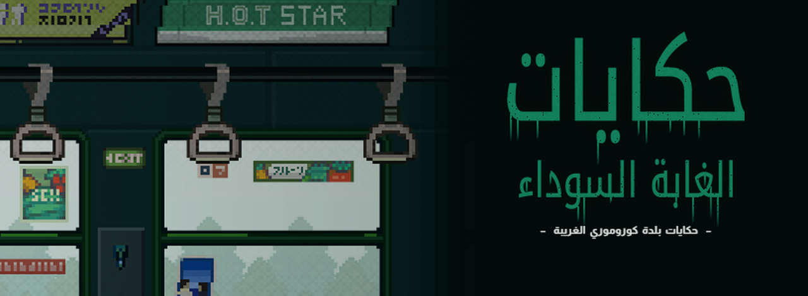

# تعريب حكايات الغابة السوداء إلى العربية

**ترجمة كاملة للعبة**

### [⬇ حمّل التعريب — النسخة اليدوية (5.4 ميجابايت)](https://github.com/AbudiHadi/tales-of-the-black-forest-arabic/raw/main/download/Tales-of-the-Black-Forest-Arabic.zip)

الإصدار 1.0.0 • كل الإصدارات: [صفحة Releases](https://github.com/AbudiHadi/tales-of-the-black-forest-arabic/releases/latest)

---

## ما الجديد في 1.0.0

- الإصدار الأول: تعريب كامل لنصوص اللعبة (الحوارات، الخيارات، القوائم، الأغراض، النصوص العائمة).
- كل الصور التي فيها كتابة معربة: الشعار، بطاقات الفصول والنهايات، التعليمات، شارة النهاية، ولافتات الخرائط.
- الواجهة كلها من اليمين إلى اليسار.
- تثبيت بنقرة واحدة (install.bat) مع نسخة احتياطية، وإلغاء كامل (uninstall.bat).

---

## ما هذا؟

تعريب كامل وغير رسمي للعبة **Tales of the Black Forest** على الكمبيوتر (نسخة Steam). النص يظهر **من اليمين إلى اليسار** بشكل
صحيح، والحروف متصلة كما يجب. وكل الصور التي فيها كتابة معرّبة أيضًا: الشعار، بطاقات الفصول، شارة النهاية، ولافتات الخرائط.

ترجمة: عبدالله هادي

---

## ما الذي تحتاجه قبل البدء

| | |
|---|---|
| اللعبة | Tales of the Black Forest على Steam (نسخة الكمبيوتر، Build 23320703) |
| برامج | لا شيء — ملف تثبيت جاهز (install.bat) |

---

## التثبيت التلقائي (دقيقة واحدة) — الطريقة المنصوح بها

> **عندك إصدار سابق من التعريب؟** نفس الخطوات: شغّل install.bat من الإصدار الجديد مباشرة.

### 1) حمّل الملف وفك الضغط

حمّل `Tales-of-the-Black-Forest-Arabic.zip` (5.4 ميجابايت) وفك الضغط عنه **كاملًا** في أي مجلد (سطح المكتب مثلًا).
**لا تفك الضغط داخل مجلد اللعبة.**

### [⬇ Tales-of-the-Black-Forest-Arabic.zip](https://github.com/AbudiHadi/tales-of-the-black-forest-arabic/raw/main/download/Tales-of-the-Black-Forest-Arabic.zip)

### 2) أغلق اللعبة وشغّل `install.bat`

اضغط مرتين على **install.bat**:

- يجد مجلد اللعبة في Steam بنفسه. إن لم يجده، اسحب مجلد اللعبة (الذي فيه `Game.exe`) إلى النافذة واضغط **Enter**.
- يتحقق من سلامة كل ملفات التعريب، ثم يحفظ نسخة من كل ملف أصلي يستبدله في المجلد `_arabic_backup` داخل مجلد اللعبة.
- ينسخ ملفات التعريب ويتحقق من كل ملف بعد النسخ.

> إن ظهرت نافذة حماية Windows (SmartScreen): اضغط **More info** ثم **Run anyway**.

### 3) شغّل اللعبة

النصوص بالعربية مباشرة — **لا توجد قائمة لغات** في هذه اللعبة.

---

## التثبيت اليدوي (بديل)

1) أغلق اللعبة. في Steam: زر الفأرة **الأيمن** على اللعبة ← **Manage** ← **Browse local files**.
2) احفظ نسخة من مجلد `www` الأصلي في مكان آمن خارج مجلد اللعبة.
3) انسخ مجلد `www` من الملف المضغوط إلى مجلد اللعبة، واختر **استبدال / Replace** عند السؤال.

---

## كيف أرجع اللعبة إلى الإنجليزية؟

- إن ثبّت بالملف `install.bat`: شغّل **uninstall.bat** — يعيد كل ملف أصلي ويحذف الملفين اللذين أضافهما التعريب، فتعود
  اللعبة كما كانت تمامًا.
- أو من Steam: زر الفأرة الأيمن على اللعبة ← **Properties** ← **Installed Files** ← **Verify integrity of game files**.

---

## أسئلة شائعة

<b>هل يؤثر التعريب على حفظ اللعبة أو الإنجازات؟</b>

 

لا. التعريب يغيّر ملفات النصوص والخطوط فقط. ملفات الحفظ والإنجازات لا تتأثر.

<b>هل يعمل مع تحديثات اللعبة القادمة؟</b>

 

عند تحديث اللعبة، يستبدل Steam الملفات المعدّلة بالملفات الأصلية، فيرجع النص للإنجليزية. شغّل install.bat مرة
أخرى بعد التحديث. إن تغيّرت نصوص اللعبة في التحديث، انتظر نسخة محدّثة من التعريب.

<b>شغّلت اللعبة ولم يتغير شيء</b>

 

تأكد أن install.bat أنهى عمله برسالة **DONE**، وأنك شغّلت اللعبة بعد إغلاقها. في التثبيت اليدوي: تأكد أنك **استبدلت** الملفات داخل مجلد `www` ولم تضف مجلدًا جديدًا بجانبه.

---

**عبدالله هادي • Abdullah Hadi**

